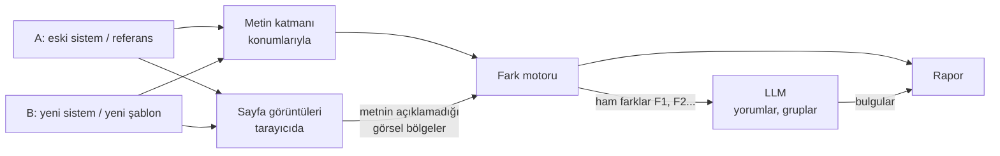

# Ekstre Karşılaştır

İki kredi kartı ekstresi PDF'ini karşılaştırır, farkları sayfa üzerinde işaretler ve kurum içi LLM'e yorumlatır. Tarayıcıdan kullanılır, yalnızca bu bilgisayarda çalışır.

| Mod | Soru | Ne zaman |
|---|---|---|
| **Dönüşüm karşılaştırma** | Eski ve yeni sistemin ekstresi aynı mı? | Eski (legacy) uygulama ile yeni uygulamanın aynı müşteri, aynı dönem için ürettiği iki ekstre. Her fark olası bir hatadır. |
| **Şablon fark analizi** | Şablonda ne değişti, istenen bu mu? | Şablonda değişiklik istendiğinde ya da "şunun gibi olsun" denen bir örnek verildiğinde. Farklar hata değil değişikliktir. |

## Başlangıç

Node 22.13+ gerekir (24 ve sonrası da olur). Başka kurulum (Docker, Python, yerel derleme) gerekmez.

```bash
npm install
npm run build
npm start
```

Sonra http://127.0.0.1:8790 adresini açın. Elinizde dosya yoksa giriş ekranındaki "Dönüşüm örneği" ve "Şablon örneği" uydurma ekstreleri yükler.

LLM tanımlamadan da çalışır: farkları makine bulur, yalnızca yorum ve gruplama olmaz.

Projeyi geliştirecek ya da kurum LLM'ine bağlayacak yazılımcı için adım adım not: [YAZILIMCI.md](YAZILIMCI.md).

## Nasıl çalışır



1. **Metin** sunucuda okunur (pdf.js): her etiket, değer ve tablo hücresi konumu ve puntosuyla bir parçadır.
2. **Fark motoru** iki belgenin parçalarını eşleştirir ve ham farkları çıkarır. LLM kullanmaz; aynı girdiye her zaman aynı sonucu verir.
3. **Sayfa görüntüleri** tarayıcıda çizilir ve hücre hücre karşılaştırılır. Metnin açıklamadığı bölgeler (logo, çizgi, kutu, renk) görsel fark olur.
4. **LLM** ham farkları okur, ilgili olanları tek bulguda toplar, önem verir ve kullanıcının notuyla eşleştirir. Belgeleri baştan okumaz.

### Bulunan fark türleri

| Tür | Örnek | Dönüşümde önem |
|---|---|---|
| Tutar ya da sayı | `12.450,75` → `12.450,57` | Kritik |
| Tarih | `07 Kasım 2026` → `08 Kasım 2026` | Kritik |
| Eksik ya da fazla satır | Bir işlem satırı yeni sistemde yok | Rakam içeriyorsa kritik, yoksa orta |
| Metin | Etiket değişmiş, Türkçe karakter kaybolmuş | Orta |
| Biçim (değer aynı) | `7 Aralık 2026` → `07.12.2026`, `1.000,00` → `1,000.00` | Orta |
| Görsel | Logo yok, kutu ya da çizgi farklı | Orta |
| Sayfa | Sayfa sayısı farklı; içerik başka sayfaya geçmiş | Sayfa sayısı kritik, diğeri orta |
| Yerleşim | Bir blok 3 mm aşağı kaymış | 10 noktadan azsa düşük |
| Punto, yazı tipi genişliği | 7 → 6,2 punto | Düşük |
| Yazım | `HESAP BİLGİLERİ` → `Hesap Bilgileri` | Düşük |

Şablon modunda hiçbir fark kritik sayılmaz: değişiklik hata değildir.

### LLM'e güven sınırı

Farkları makine bulur; LLM yalnızca yorumlar. `sunucu/src/analiz.ts` şu kuralları uygular ve testler korur:

- **LLM fark silemez.** Değinmediği her ham fark makine bulgusu olarak rapora girer.
- **LLM fark uyduramaz.** Bilinmeyen kimlikler atılır; hiçbir farka dayanmayan bulgu "Kanıtsız" işaretlenir ve hükmü etkilemez.
- **LLM türleri karıştıramaz.** Bir bulgu yalnızca aynı türden farkları toplar; tutar farkını biçim farkıyla aynı başlığa koyarsa o bulgu alınmaz.
- **Dönüşümde LLM önemi düşüremez.** Kuralın verdiği önem tabandır. Tek istisna: "bilinen farklar" notunuzun o farkı kapsadığına LLM karar verirse fark "Bilinen fark" olur. Bu karar LLM'indir; bilinen fark sayılanları gözden geçirin.
- **Hüküm kuralla verilir.** Üstteki hüküm LLM'in özetinden değil bulgulardan hesaplanır.

Ekranda LLM'in yazdığı her bulgunun altında dayandığı ham fark görünür: yorum ile kanıt yan yana durur.

## Ayarlar

Sağ üstteki **Ayarlar** düğmesinden yapılır. Ayarlar proje klasörünün dışında, `~/.ekstre-karsilastir/ayar.json` dosyasında durur (klasörü `EKSTRE_AYAR_KLASORU` ile değiştirebilirsiniz).

### Kurum içi LLM

OpenAI uyumlu bir servis gerekir (`POST /v1/chat/completions`; `GET /v1/models` varsa model listesi gelir).

| Ayar | Açıklama | Varsayılan |
|---|---|---|
| Servis adresi | Taban adres, genellikle `/v1` ile biter. Örnek: `http://llm.kurum.local/v1` | boş (LLM kapalı) |
| Model | Servisteki model adı. "Bağlantıyı sına" listeyi getirir. | boş |
| Anahtar nasıl gönderilsin | `Authorization: Bearer`, `api-key`, `x-api-key` ya da anahtarsız | Bearer |
| API anahtarı | Yalnızca bu oturum için bellekte ya da bu bilgisayarda dosyada saklanır | yok |
| Model görsel girdi kabul ediyor | Açıksa ilk altı sayfanın görüntüsü de modele gider | kapalı |
| Zaman aşımı | Tek LLM isteği için saniye | 600 |
| En fazla çıktı token'ı | Düşünen modellerde düşünme de bu sınırdan yer | 4096 |
| Sıcaklık | | 0 |
| İstek gövdesine ek (JSON) | Her isteğe eklenen alanlar. Düşünmeyi kapatmak için kullanılır (aşağıya bakın). | `{}` |
| Sistem istemine ek | Sistem isteminin sonuna eklenen metin | boş |

**Bağlantıyı sına** kaydetmeden dener: model listesi, kısa bir sohbet ve (açıksa) görsel girdi.

**Anahtar.** Ayar dosyasına yazılmaz, hiçbir API yanıtında ya da hata mesajında yer almaz. Üç kaynaktan, bu öncelikle okunur:

1. `EKSTRE_LLM_ANAHTAR` ortam değişkeni
2. `~/.ekstre-karsilastir/anahtar` dosyası (yalnızca sahibi okuyabilir; Windows'ta bu izin uygulanmaz)
3. Bellek (uygulama kapanınca unutulur)

**Düşünen modeller (Qwen3 gibi).** Yanıttan önce uzun uzun düşünürler; bu süreyi birkaç kat uzatır. Düşünmeyi kapatan alan sunucuya göre değişir:

| Sunucu | İstek gövdesine ek | Durum |
|---|---|---|
| Ollama | `{"reasoning_effort": "none"}` | Denendi, çalışıyor |
| vLLM (Qwen3) | `{"chat_template_kwargs": {"enable_thinking": false}}` | Denenmedi |

Ollama'da sistem istemine `/no_think` eklemek düşünmeyi kapatmadı.

### Karşılaştırma

| Ayar | Açıklama | Varsayılan |
|---|---|---|
| Konum toleransı | Aynı metin bu kadar noktadan az oynadıysa kayma sayılmaz (1 nokta ≈ 0,35 mm) | 2 |
| Punto toleransı | | 0,4 |
| LLM'e en fazla fark | Aşılırsa en önemlileri gider, gerisi kuralla değerlendirilir | 120 |
| Uzun numaraları maskele | LLM'e giden metinde 10 haneden uzun rakam dizilerinin yalnızca son dört hanesi kalır | açık |

İki sistem farklı çizim motoru kullanıyorsa ve her şey "kaymış" görünüyorsa konum toleransını artırın.

## Veri nereye gider

- Dosyalar tarayıcıda ve bu bilgisayardaki sunucuda işlenir. **Diske yazılmaz, günlüğe girmez, saklanmaz.**
- Sunucu yalnızca `127.0.0.1` üzerinde dinler; başka adresten ya da başka siteden gelen isteği reddeder.
- Dışarıya giden tek şey ayarladığınız LLM'e gönderilen istektir: bulunan farkların metni (etiket, eski ve yeni değer, satırın kalanı) ve yazdığınız not. Belgenin tamamı gitmez. Görsel girdi açıksa ilk altı sayfanın görüntüsü de gider.
- Maskeleme kart, hesap, kimlik ve IBAN gibi uzun numaraları kapatır. **İsim, adres ve tutarlar maskelenmez**; LLM kurum dışındaysa bunu hesaba katın.
- İndirilen rapor ekstre içeriği taşır.

## Ölçüm

Tek bir ölçüm yapıldı: bu depodaki örnek ekstreler, `qwen3:8b` (Ollama, dizüstü bilgisayar), birer koşu. Kurum LLM'iyle ve gerçek dönüşüm çıktılarıyla henüz denenmedi.

| Koşu | Düşünme | Süre | Sonuç |
|---|---|---|---|
| Dönüşüm, 14 ham fark | kapalı | 126 sn | Kritik farkların hepsi raporda ve doğru önemde. Modelin türleri karıştırdığı bulgular alınmadı; o farklar makine bulgusu olarak göründü. |
| Dönüşüm, 14 ham fark (uygulama dışından, aynı istem) | açık | 281 sn | Gruplama ve açıklamalar belirgin biçimde daha isabetli |
| Şablon + istek notu, 15 ham fark | kapalı | 113 sn | İstenen iki değişikliği doğru eşleştirdi; **karşılanmayan isteği kaçırdı, yerine yanlış bir istek yazdı** |
| Şablon + istek notu, 15 ham fark | açık | 269 sn | Yapılan beş isteği doğru eşleştirdi, karşılanmayan isteği buldu. İstenmemiş etiket değişikliğini işaretlemedi (hüküm onu "eşleştirilemedi, elle bakın" diye öne çıkardı); ilgisiz iki kaymayı logo taşınmasına bağladı. |

Çıkan sonuç:

- Makine farkları ve hüküm modelden etkilenmez; iki ayarda da kritik farkların hepsi raporda.
- 8 milyar parametreli model düşünme açıkken işe yarar bir yorum veriyor ama kusursuz değil; düşünme kapalıyken şablon modundaki istek eşleştirmesine güvenilmez.
- "İstenen", "İstenmemiş" ve "Karşılanmayan istekler" LLM'in kararıdır. Daha büyük bir modelle yeniden ölçülmeli.

## Sınırlar

- **Şablon eşleştirmesi LLM'e bağlıdır.** İstek notu ile farkların eşleştirilmesini yalnızca LLM yapar; LLM yoksa ya da zayıfsa yalnızca "ne değişti" listesi güvenilirdir.
- **"Yalnızca şablonu karşılaştır" yaklaşıktır.** Rakamlar ve tarihler yok sayılır, ama işlem sayısı farklıysa satırlar eksik ya da fazla görünür.
- **Taranmış ekstre (metin katmanı olmayan PDF, PNG, JPG)** için yalnızca görüntü farkı çıkar; metin karşılaştırılmaz. OCR yoktur.
- **Görüntü farkı aynı sayfa numaralarını karşılaştırır.** İçerik başka sayfaya kaydıysa o sayfaların görüntüsü bütünüyle farklı çıkar; metin karşılaştırması bundan etkilenmez.
- **İki sistem farklı yazı tipi kullanıyorsa** görüntü farkı metnin her yerinde yanar. Bu yüzden metnin üstüne düşen görüntü farkları bulgu yapılmaz; yalnızca "Görüntü farkı" katmanında görünür.
- **Çok ince ve soluk çizgiler** görüntü karşılaştırmasında kaçabilir.
- **LLM istekleri akışsızdır:** yanıt bitene kadar ekranda yalnızca süre görünür.
- **Toplu çalıştırma yok.** Bir seferde bir çift karşılaştırılır.
- En fazla 200 sayfa, dosya başına 40 MB.
- Windows'ta yalnızca otomatik denetimle sınandı (kurulum, testler, derleme, sunucunun açılışı); ekran bir Windows tarayıcısında elle denenmedi.

## Sorun giderme

| Belirti | Neden ve çözüm |
|---|---|
| `LLM servisine ulaşılamadı (ECONNREFUSED / ENOTFOUND)` | Adres yanlış ya da servis kapalı. Adresi ve ağ erişimini kontrol edin. |
| `LLM servisi anahtarı kabul etmedi (401 / 403)` | Anahtar ya da anahtar başlığı yanlış. Ayarlarda diğer başlık türlerini deneyin. |
| `adres ya da model bulunamadı (404)` | Taban adres `/v1` ile bitmiyor olabilir ya da model adı yanlış. |
| `sertifikası doğrulanamadı` | Servis kurum içi bir sertifika kullanıyor. Kök sertifikayı tanıtın: `NODE_EXTRA_CA_CERTS=/yol/kurum-kok.pem npm start` |
| `LLM N saniyede yanıt vermedi` | Zaman aşımını artırın, düşünmeyi kapatın ya da "LLM'e en fazla fark" değerini düşürün. Dizüstünde kapağı kapatmak isteği yarıda bırakır. |
| `LLM boş yanıt döndü` | Çıktı token sınırı düşünme aşamasında tükendi. Sınırı artırın ya da düşünmeyi kapatın. |
| `Model iki denemede de geçerli JSON üretmedi` | Model küçük ya da sıcaklık yüksek. Sıcaklığı 0 yapın; olmuyorsa daha büyük bir model deneyin. Rapor yine makine farklarıyla çıkar. |
| Uyarı: `LLM'in N bulgusu ... alınmadı` | Model farklı türden farkları tek başlıkta topladı. Bilgi amaçlıdır; o farklar makine bulgusu olarak raporda durur. |
| Her şey "kaymış" görünüyor | İki sistemin çizim motoru farklı. Konum toleransını artırın. |
| `metin katmanı yok` uyarısı | Dosya taranmış görüntü. Yalnızca görüntü farkı çıkar. |
| `Bu uygulama Node.js 22.13 ya da daha yenisini ister` | Node eski; güncelleyin. PDF kütüphanesi (pdf.js) Node 22.13+ ister; Node 20 ile testler geçmiyor. |
| `Port 8790 kullanımda` | Uygulama zaten açık ya da port dolu: `npm start -- --port 9000` |
| Sayfada "Arayüz derlenmemiş" yazıyor | `npm run build` çalıştırın. |

## Geliştirme

| Komut | Ne yapar |
|---|---|
| `npm start` | Sunucu ve derlenmiş arayüz: http://127.0.0.1:8790 (`--port` ya da `EKSTRE_PORT` ile değişir) |
| `npm run gelistir` | Vite (5190); API isteklerini çalışan sunucuya yönlendirir |
| `npm run build` | Arayüzü `arayuz/dist`'e derler |
| `npm test` | Vitest. Ağa çıkmaz; LLM yerine sahte bir OpenAI uyumlu sunucu kullanır |
| `npm run typecheck` | Sunucu ve arayüz |
| `npm run duman` | Uygulamayı gerçekten açar, örnek ekstreleri LLM'siz karşılaştırır (önce `npm run build`) |
| `npm run ornek` | `ornekler/` altındaki uydurma ekstre PDF'lerini yeniden üretir |

Bir değişikliği bitmiş saymadan önce: `npm run typecheck && npm test && npm run build`.

Her gönderimde aynı denetimler ve duman testi GitHub'da Windows (Node 22 ve 24), Linux ve macOS üzerinde otomatik koşar (`.github/workflows/denetim.yml`). Bu, kurulumun ve sunucunun o işletim sistemlerinde çalıştığını gösterir; tarayıcıdaki ekranı sınamaz.

| Yol | Ne |
|---|---|
| `sunucu/src/pdf.ts` | PDF metin katmanını konumlarıyla okur, parçalara böler |
| `sunucu/src/fark.ts` | Fark motoru: eşleştirme, sınıflandırma, kuralla önem |
| `sunucu/src/metin.ts` | Tutar ve tarih çözme, benzerlik, maskeleme |
| `sunucu/src/istem.ts` | LLM'e giden istem |
| `sunucu/src/llm.ts` | OpenAI uyumlu istemci, bağlantı sınama |
| `sunucu/src/analiz.ts` | Karşılaştırmanın tamamı; LLM'e güven sınırı; hüküm |
| `sunucu/src/ayarlar.ts` | Ayar dosyası, doğrulama, anahtar |
| `sunucu/src/sunucu.ts`, `tipler.ts` | Fastify API; sunucu ile arayüzün paylaştığı tipler |
| `arayuz/src/belge.ts` | Sayfa çizimi ve görüntü karşılaştırması (tarayıcıda) |
| `arayuz/src/` | Vite + React arayüz |
| `araclar/ornek-uret.ts` | Örnek ekstre üreticisi |
| `ornekler/` | Uydurma örnekler: banka, müşteri, kart ve işlemler gerçek değildir |

Gerçek ekstreleri depoya koymayın. Denemek için `gercek/` klasörünü kullanabilirsiniz; `.gitignore` onu dışarıda tutar.
